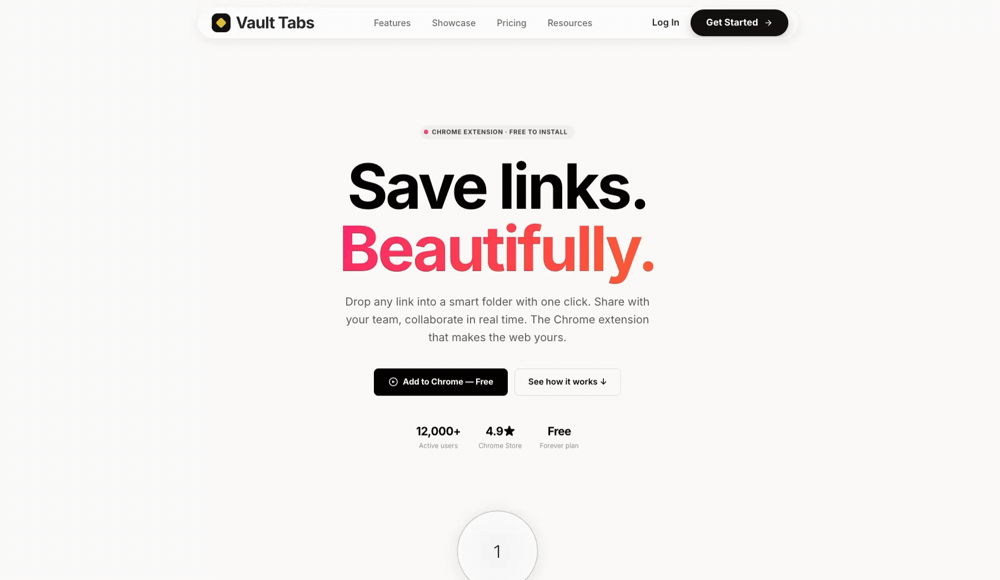

<h1 align="center">Vault Tabs</h1>

<p align="center">
  A polished landing page that helps people save, organize, and share links beautifully.
</p>

<p align="center">
  
  
  
  
  
</p>

<p align="center">
  <a href="#overview">Overview</a>
  ·
  <a href="#getting-started">Getting Started</a>
  ·
  <a href="#page-experience">Page Experience</a>
  ·
  <a href="#project-structure">Project Structure</a>
  ·
  <a href="#deployment">Deployment</a>
</p>

<br />

<p align="center">
  
</p>

## Overview

Vault Tabs is a responsive marketing landing page for a link-management and Chrome extension product. The visual direction combines a clean editorial layout with bold gradient typography, glassmorphism navigation, animated 3D scenes, and scroll-triggered transitions.

The page communicates a simple product promise: save links into smart folders, share them with a team, and turn browser clutter into an organized digital vault.

The current landing page includes:

- A floating glass navigation bar with product, resource, login, and call-to-action links
- An animated hero section with the “Save links. Beautifully.” headline
- Product metrics and Chrome extension call-to-action buttons
- A scroll-driven 3D link-vault showcase
- Animated folder, link-card, and resource visualizations
- Pricing cards for Free, Pro, and Team plans
- A final conversion-focused CTA section
- Responsive layouts and reduced-motion handling
- Reusable animation helpers built with GSAP, ScrollTrigger, and Lenis

## Tech stack

- **React 19 + TypeScript** — typed UI composition and application structure
- **Vite 7** — development server and production bundling
- **Tailwind CSS 4** — utility styling and Vite integration
- **Three.js** — 3D rendering primitives
- **React Three Fiber** — declarative React bindings for Three.js
- **React Three Drei** — cameras, environments, shadows, and scene helpers
- **GSAP + ScrollTrigger** — entrance and scroll-based animations
- **Lenis** — smooth scrolling
- **Lucide React** — interface icons
- **Wouter** — lightweight routing support for future page flows

## Requirements

- Node.js 18 or newer
- npm
- A modern browser with WebGL support for the 3D showcase

## Getting started

From the `Vault Tabs` directory, install dependencies and start the development server:

```bash
npm install
npm run dev
```

Open [http://localhost:3000](http://localhost:3000) in a browser.

The Vite server listens on all interfaces, so the project can also be opened from another device on the same network when the development machine firewall allows it.

No backend service or environment variable is required for the current landing page.

## Available scripts

Run these commands from `Vault Tabs/`:

| Command | Description |
| --- | --- |
| `npm run dev` | Start the Vite development server on port 3000 |
| `npm run build` | Build the production frontend into `dist/public/` |
| `npm run serve` | Preview the production build locally |
| `npm run typecheck` | Run the TypeScript no-emit check |

The port can be overridden with the `PORT` environment variable:

```bash
PORT=4000 npm run dev
```

The Vite base path can be configured with `BASE_PATH` when deploying below a subpath:

```bash
BASE_PATH=/Vault Tabs/ npm run build
```

## Page experience

### 1. Navigate the landing page

The fixed, translucent navigation bar uses a rounded glass panel that tightens toward the top of the viewport after scrolling. Its links and primary CTA currently act as presentation placeholders.

### 2. Explore the hero

The hero introduces the product with a large black-and-pink gradient headline, a Chrome extension badge, product metrics, and two primary actions. GSAP sequences the badge, headline, supporting copy, and buttons into view.

### 3. Watch the vault transformation

The 3D showcase tracks scroll progress through a tall pinned section. Link cards and folder elements move through the scene while supporting copy fades in and out to describe automated tab gathering.

### 4. Compare plans

The pricing section presents three sample plans:

- **Free** — personal link collection
- **Pro** — unlimited folders and links for power users
- **Team** — shared folders and collaboration features

The pricing values and plan capabilities are static presentation content at this stage.

### 5. Convert with the final CTA

The closing CTA reinforces the free Chrome extension offer with a dark, gradient-accented panel and animated entrance. The buttons are currently placeholder links ready to be connected to the Chrome Web Store and product routes.

## Project structure

```text
.
├── public/
│   ├── favicon.svg                    # Browser tab icon
│   └── opengraph.jpg                  # Social preview image
├── src/
│   ├── components/
│   │   ├── Navbar.tsx                 # Floating glass navigation
│   │   ├── HeroSection.tsx            # Hero copy, stats, and CTAs
│   │   ├── Scene.tsx                  # Scroll-driven 3D vault experience
│   │   ├── ArcFeatures.tsx            # Feature arc and process visualization
│   │   ├── PricingSection.tsx         # Free, Pro, and Team pricing cards
│   │   ├── CTASection.tsx             # Closing conversion section
│   │   ├── Footer.tsx                 # Footer content
│   │   ├── FeaturesSection.tsx        # Additional feature section
│   │   ├── SocialProof.tsx            # Social proof section
│   │   ├── LinkVaultBanner.tsx        # Link-vault promotional banner
│   │   └── ScrollFileDrop.tsx         # Scroll-based file drop visualization
│   ├── hooks/
│   │   └── use-mobile.tsx             # Mobile viewport helper
│   ├── lib/
│   │   └── utils.ts                   # Shared class-name utility
│   ├── constants.ts                   # Demo folders and link-card data
│   ├── App.tsx                        # Page composition and smooth-scroll setup
│   └── main.tsx                       # React entry point
├── index.html                         # Vite HTML shell and page metadata
├── package.json                        # Scripts and dependencies
├── tsconfig.json                       # TypeScript configuration
└── vite.config.ts                      # Vite, aliases, and build configuration
```

## Production build

Run the type check and build the static frontend:

```bash
npm run typecheck
npm run build
```

The compiled frontend is written to `dist/public/`. Preview the generated output with:

```bash
npm run serve
```

## Deployment

Deploy the project to any static hosting provider that supports Vite builds.

| Setting | Value |
| --- | --- |
| Install command | `npm install` |
| Build command | `npm run build` |
| Output directory | `dist/public` |
| Preview command | `npm run serve` |

For deployment under a subpath, set `BASE_PATH` during the build. For example:

```bash
BASE_PATH=/Vault Tabs/ npm run build
```

The 3D showcase requires WebGL. The page remains usable as a marketing layout in browsers that do not support the full rendering experience, but the 3D scene cannot be displayed without WebGL.

## Current implementation notes

- The project is currently a frontend-only landing page with no authentication, database, Chrome extension package, or API service.
- Navigation, pricing, login, and Chrome Store buttons use placeholder `#` links until product routes are connected.
- `FeaturesSection` and `SocialProof` are available as components but are currently not mounted in `App.tsx`.
- The displayed metrics and pricing information are static demo content.
- The app respects `prefers-reduced-motion` by disabling the Lenis animation loop when reduced motion is requested.

## License

No project-wide license has been declared yet. Add a license before distributing the project publicly.
